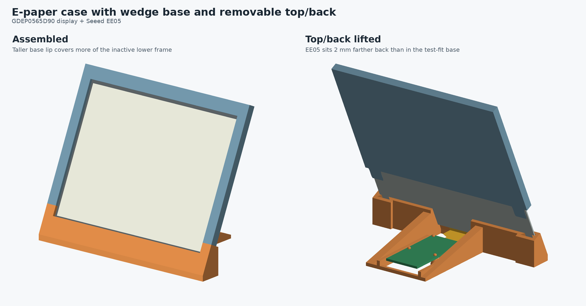

# Two-piece e-paper display case

This OpenSCAD desk case fits the **Good Display GDEP0565D90** panel and the **Seeed EE05 V1.11** development board. The lower display cradle and the EE05 mount print as one wedge base. Load the panel, ribbon, and board into that base with the back open, then slide the top/back down behind the display. Two tapered dovetails at the outside edges hold the seam by friction, without screws or glue.



## Print files

| File | Part | Print orientation |
| --- | --- | --- |
| [`epaper_base.stl`](epaper_base.stl) | Lower display cradle, wedge, and EE05 mount | Flat rear/underside face on the bed, with the EE05 pins pointing up |
| [`epaper_top.stl`](epaper_top.stl) | Top lip, side bezel, and full-width back panel | Rotate **−90° about X** from the STL orientation to print on the long top edge, with the keys pointing up |
| [`epaper_holder.scad`](epaper_holder.scad) | Parametric source | Select `base`, `top`, or `assembly` with `part` |

Both parts fit on a Bambu A1 mini. Print the base as supplied, flat with supports off. For the top/back, use **Lay on Face** in your slicer to put its long top edge on the bed. This lets the retaining lip print without a bridge or supports. On a bed-slinger, run that edge front to back, parallel to bed travel, and use an 8–10 mm outer brim.

Start with 0.20 mm layers and four wall loops in PLA or PETG. Remove any strings or first-layer flare that could catch the glass or obstruct the dovetails.

To export both parts from the same settings:

```sh
openscad -o epaper_base.stl epaper_holder.scad
openscad -D 'part="top"' -o epaper_top.stl epaper_holder.scad
```

## Assembly

1. **Dry-fit the printed parts first.** Align the two top/back keys with the sockets and slide the top down along the screen plane. The keys should move freely until the last part of travel, then grip as the seam closes. Pull the top straight up to remove it.
2. **Load the electronics with the back off.** Drop the panel's lower edge in from above, feeding the flex through the notch behind the continuous front lip. Keep the EE05 behind the panel; the notch is open to the rear, so you don't have to push a connected PCB through a closed slot. Connect the ribbon and seat the board on the four pins while the notch is accessible. If the ribbon is already connected, lower the panel and board together without loading the cable.
3. **Install the top/back.** Support the glass until the cover is seated. With the panel fully down and the flex clear of the seam, start the top above the glass and slide it straight down. The backing passes behind the glass and the top lip captures its upper edge. Don't force it against the panel or pinch the ribbon.

The default joint interference is **0.08 mm per flank**, measured across each key at its root. Reduce `joint_interference` toward zero or below if the fit is tight, or increase it in small steps if it's loose. This parameter only changes the keys, so you can reprint just the top/back to tune the fit. The display slot and board pins have their own clearances and should not be used to tighten the case joint.

## Dimensions and customization

All dimensions are in millimetres.

| Feature | Default |
| --- | --- |
| Panel outline | 125.40 × 99.50 × 0.95 mm (nominal thickness with film) |
| Active area | 114.90 × 85.79 mm, 5.25 mm from the left and 9.11 mm from the bottom |
| Panel slot | 1.35 mm thick, with 0.50 mm clearance at each locating edge |
| Front lip overlap | 3.00 mm at the upper edge; 8.25 mm above the seated lower edge, leaving 0.86 mm before the nominal active area |
| Side bezel overlap | 4.00 mm onto the glass on each side, with clearance from the active area |
| Ribbon opening | Left edge 50.00 mm from the left edge of the glass; right edge 82.47 mm from that same edge |
| Ribbon | 23.00 mm wide at the panel end. The 12.50 mm-wide connector tail starts 55.47 mm from the left edge of the glass per the drawing, so its centre and the EE05 connector are at 61.72 mm. The tail extends 24.01 mm below the panel. |
| EE05 outline in the holder | 25.00 × 52.16 mm, with four 2.50 mm mounting holes |
| EE05 side clearance | 3.00 mm from each PCB edge to the side rails for the buttons and switch (`board_side_clearance`) |
| Stud pins | 2.20 mm diameter, with tapered tips |
| Display angle above desk | 65° |

To move the ribbon sideways, change `ribbon_base_center_from_left` and reprint only the base. The loading notch and EE05 mount follow the ribbon, while the edge joints on the top/back stay put. Changing `board_horizontal_offset` moves the EE05 independently without moving the notch. `board_vertical_offset` defaults to −6.00 mm to set the EE05 farther back for the ribbon. Make it more negative to move the board farther from the display, or closer to zero if the ribbon is taut. Check the fit with the actual cable before seating the PCB on the pins.

`split_height` moves the seam along the panel plane; keep it above the lower lip and below the upper lip. `board_foot_angle` is `180 - desired_display_angle` and ranges from 90° to 140°. Set `add_board_studs = false` to keep the wedge but omit the board rails and pins. Re-export both parts after changing dimensions that affect the seam, such as case width or split height.

For a preview, set `part = "assembly"`, `show_display = true`, and `show_dev_board = true`. Set `top_separation = 25` to expose the keys and the loading opening. The ribbon path and populated PCB are illustrative; check the actual ribbon bend and component clearance during assembly.

## References

- [Good Display GDEP0565D90 datasheet](https://v4.cecdn.yun300.cn/100001_1909185148/GDEP0565D90.pdf), revision 1.2, page 7: glass, active area, and ribbon dimensions.
- [Seeed EE05 V1.11 PCB archive](https://files.seeedstudio.com/wiki/Epaper/EE05/XIAO_ePaper_Display_Board_EE05_V1.11_SCH&PCB_260420.zip): mounting-hole and connector positions.

The manufacturer files are linked rather than included. The case can be regenerated from the OpenSCAD source without either download.
